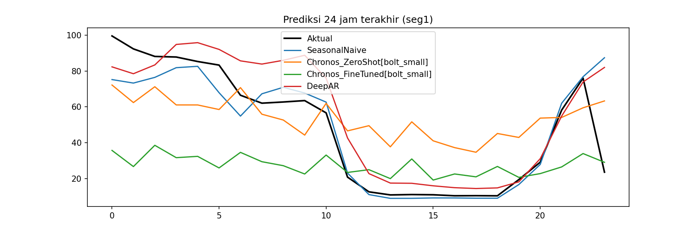

# Peramalan Konsumsi Daya Listrik dengan Transfer Learning

Proyek peramalan konsumsi daya per jam (`MAIN_POWER_HOURLY`) menggunakan **transfer learning** dengan foundation model time series **Chronos-Bolt** (Amazon), dibandingkan dengan baseline dan model yang dilatih dari nol.

## Data
`data/datapbl.xlsx` berisi 3.781 pengamatan per jam (23 Juli 2025 – 9 April 2026).

Pra-pemrosesan:
- 17 outlier sensor (nilai negatif atau > 200) dibuang.
- Data di-resample per jam; celah ≤ 24 jam diinterpolasi.
- Celah yang lebih panjang (hingga 882 jam) tidak diisi paksa, sehingga data dipecah menjadi **5 segmen kontinu** (panjang 517, 560, 512, 384, 1249 jam). Tiap segmen diperlakukan sebagai satu deret waktu.

## Metode
| Model | Keterangan |
|---|---|
| SeasonalNaive | Baseline: mengulang pola 24 jam sebelumnya |
| Chronos-Bolt zero-shot | Transfer learning tanpa pelatihan tambahan |
| Chronos-Bolt fine-tuned | Transfer learning + fine-tuning di data ini |
| DeepAR | Jaringan saraf dilatih dari nol (tanpa transfer learning) |

Horizon prediksi 24 jam. Evaluasi dilakukan pada **24 jam terakhir tiap segmen**. Metrik: MAE, RMSE, MAPE. Pelatihan dibatasi (`time_limit`) karena memakai Google Colab gratis.

## Cara menjalankan
1. Buka `notebooks/power_forecasting_transfer_learning.ipynb` di Google Colab (GPU T4).
2. Upload `data/datapbl.xlsx`, sesuaikan `PATH` jika perlu, lalu **Run all**.
3. Hasil tersimpan sebagai `results_metrics.csv` dan `results_forecast.png`.

Atau lokal: `pip install -r requirements.txt`, lalu jalankan notebook.

## Hasil
| Model | MAE | RMSE | MAPE |
|---|---|---|---|
| SeasonalNaive | 8,34 | 15,50 | 23,0% |
| DeepAR | 12,43 | 17,72 | 39,4% |
| Chronos zero-shot | 22,88 | 25,18 | 114,9% |
| Chronos fine-tuned | 28,65 | 35,17 | 67,9% |

## Kesimpulan
Model terbaik pada data uji adalah **SeasonalNaive** (MAE 8,34; RMSE 15,50). Pendekatan transfer learning dengan Chronos tidak mengungguli baseline pada data ini: Chronos zero-shot memiliki MAE 22,88 (sekitar 174% lebih buruk dari baseline) dan Chronos fine-tuned MAE 28,65 (sekitar 243% lebih buruk).

Fine-tuning tidak memperbaiki hasil zero-shot pada MAE dan RMSE (MAE naik dari 22,88 menjadi 28,65), meskipun MAPE-nya turun dari 114,9% menjadi 67,9%. Model DeepAR yang dilatih dari nol (MAE 12,43) juga lebih baik daripada kedua varian Chronos, tetapi masih di bawah baseline.

Kemungkinan penyebabnya: pola konsumsi daya sangat dipengaruhi siklus harian sehingga baseline yang mengulang pola kemarin sudah sangat kuat; data hanya sekitar lima bulan dan terpecah menjadi lima segmen sehingga fine-tuning mudah tidak stabil; serta evaluasi hanya pada 24 jam terakhir tiap segmen sehingga hasilnya sensitif terhadap hari tertentu. MAPE juga mudah membesar ketika nilai aktual kecil.

Keterbatasan: data pendek, adanya celah pengukuran panjang, outlier sensor yang dibuang, pelatihan dibatasi oleh komputasi Colab gratis, dan periode uji yang singkat.

Saran: menambah data, mengevaluasi pada lebih banyak window, menambah fitur kalender (hari libur), menyetel fine-tuning (langkah dan learning rate), serta mencoba model Chronos yang lebih besar.